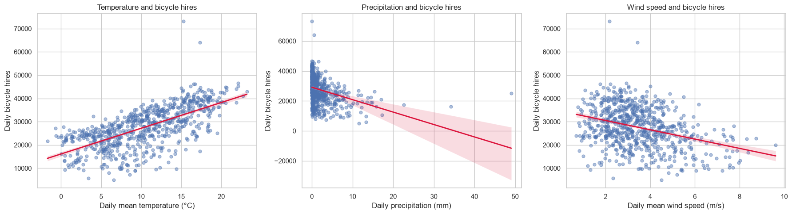
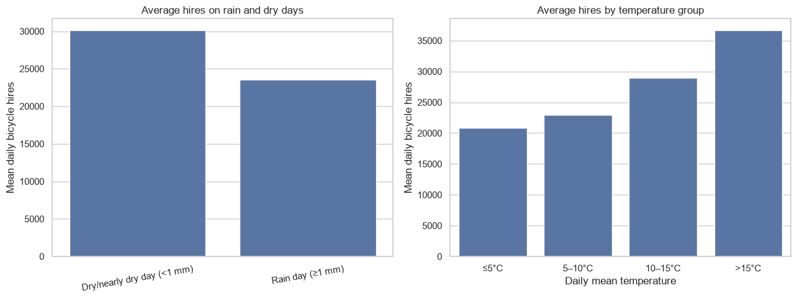

# Weather Conditions and Bike-Sharing Demand in London

Daily Santander Cycle hires in London (2015–2016) analysed against daily temperature,
precipitation, and wind speed.





## 1. Problem and research question

**Research question.** How were daily temperature, precipitation, and wind speed associated
with daily Santander Cycle hires in London during 1 January 2015 – 31 December 2016?

**Hypotheses.**

1. Higher temperatures are associated with more daily bicycle hires.
2. Higher precipitation is associated with fewer daily bicycle hires.
3. Higher wind speeds are associated with fewer daily bicycle hires.

**Motivation.** Bike-sharing operators need to anticipate demand swings caused by weather so
that redistribution, maintenance, and staffing can be planned ahead of time.

## 2. Dataset sources and usage permissions

| Dataset | Source | Access |
| --- | --- | --- |
| Number of Bicycle Hires (TfL Santander Cycles), daily counts | [London Datastore – Number of Bicycle Hires](https://data.london.gov.uk/dataset/number-of-bicycle-hires-2r84d) | Open data, published by Transport for London for public reuse |
| Daily meteorology (T2M temperature, PRECTOTCORR precipitation, WS2M wind speed) | [NASA POWER Daily Point API](https://power.larc.nasa.gov/) | Public NASA dataset, free to use with attribution |

- Local copy of the TfL workbook: `data/tfl-daily-cycle-hires.xlsx` (148 KB, original file, unmodified).
- The weather series is fetched at run time from the NASA POWER API, so an internet connection
  is required on the first run.
- Both sources are open public datasets. This repository contains **no** personal data,
  credentials, API keys, or restricted material.
- Attribution: Transport for London (bicycle hires) and NASA POWER (meteorology).

## 3. Methods and tools

**Tools.** Python 3, `pandas`, `numpy`, `matplotlib`, `seaborn`, `scipy.stats`,
`scikit-learn`, `openpyxl`, Jupyter Notebook.

**Pipeline.**

1. **Load and clean.** The TfL workbook carries title rows above the daily table, so rows 0–5
   are skipped and columns 1–2 are kept as `date` and `daily_hires`. The NASA POWER CSV carries
   metadata above its header, so the header row is located by searching for `YEAR,`.
2. **Merge and validate.** The two tables are inner-joined one-to-one on `date` and sorted,
   producing **731 rows** from 2015-01-01 to 2016-12-31 with **0 duplicate dates** and
   **0 missing values**.
3. **Describe and correlate.** Descriptive statistics plus Pearson and Spearman correlation
   coefficients between each weather variable and daily hires.
4. **Visualise.** Three scatter plots with fitted linear trends, and grouped bar charts
   comparing rain days with dry days and comparing temperature bands.
5. **Model.** A multiple linear regression on standardised variables, controlling for day of
   week, month, and year so that the three weather variables can be compared on one scale.

## 4. Key findings

Descriptive statistics over 731 days: mean daily hires **27,600** (SD 8,713; range 4,894–73,094);
mean temperature **10.37 °C**; mean precipitation **1.87 mm**; mean wind speed **3.46 m/s**.

| Weather variable | Pearson r | Spearman rho | Standardised regression coefficient |
| --- | --- | --- | --- |
| Temperature (°C) | **+0.666** | +0.697 | **+0.422** |
| Precipitation (mm) | **−0.345** | −0.484 | **−0.343** |
| Wind speed (m/s) | **−0.345** | −0.316 | **−0.169** |

1. **Temperature is the strongest driver.** Warmer days are clearly associated with more hires
   (r = +0.666). Grouped means rise monotonically from 20,833 hires on days at or below 5 °C,
   to 22,979 (5–10 °C), 28,977 (10–15 °C), and 36,697 above 15 °C.
2. **Rain suppresses demand.** Days with at least 1 mm of precipitation averaged 23,505 hires
   across 280 days, versus 30,142 hires across 451 drier days — a **22.0 % reduction**.
3. **Wind matters less.** Wind speed correlates negatively with hires (r = −0.345) but has the
   smallest standardised effect (−0.169) once the other variables are controlled for.
4. **The model explains most of the variance.** R² = **0.783** for the standardised regression
   with calendar controls, and all three associations keep their direction, so all three
   hypotheses are supported.

**One limitation.** The analysis demonstrates **association, not causation**. NASA POWER supplies
model-based meteorological estimates for a single grid point representing central London rather
than measurements from every location in the city, and unmodelled factors such as public
holidays, major events, transport disruptions, and changes to the cycle-hire system also
influence daily demand.

## 5. Instructions for running the analysis

```bash
git clone https://github.com/demonsaker/data-science-project.git
cd data-science-project

python -m venv .venv
# Windows: .venv\Scripts\activate    macOS/Linux: source .venv/bin/activate
pip install -r requirements.txt

jupyter notebook CISC7204_Assignment1_Group_Ma_Qiu.ipynb
```

Then run all cells in order. The notebook will:

1. read `data/tfl-daily-cycle-hires.xlsx` (already included in this repository);
2. download the NASA POWER weather series for 2015-01-01 to 2016-12-31 (internet required);
3. print the data-quality report, descriptive statistics, correlation table, rain-day and
   temperature-band summaries, and the regression output;
4. render the figures, which are also committed under `figures/`.

Only the NASA POWER API is contacted; no API key or authentication is needed.

## Repository layout

```
data-science-project/
├── CISC7204_Assignment1_Group_Ma_Qiu.ipynb   # full analysis
├── data/tfl-daily-cycle-hires.xlsx           # TfL daily hire counts (open data)
├── figures/figure_1.png                      # scatter plots with fitted trends
├── figures/figure_2.png                      # rain-day and temperature-band bars
├── requirements.txt
└── README.md
```

## Author

Qiu Qizu (MC663472) — group project with Ma, submitted for CISC7204 Data Science and
Data Visualization, University of Macau.
